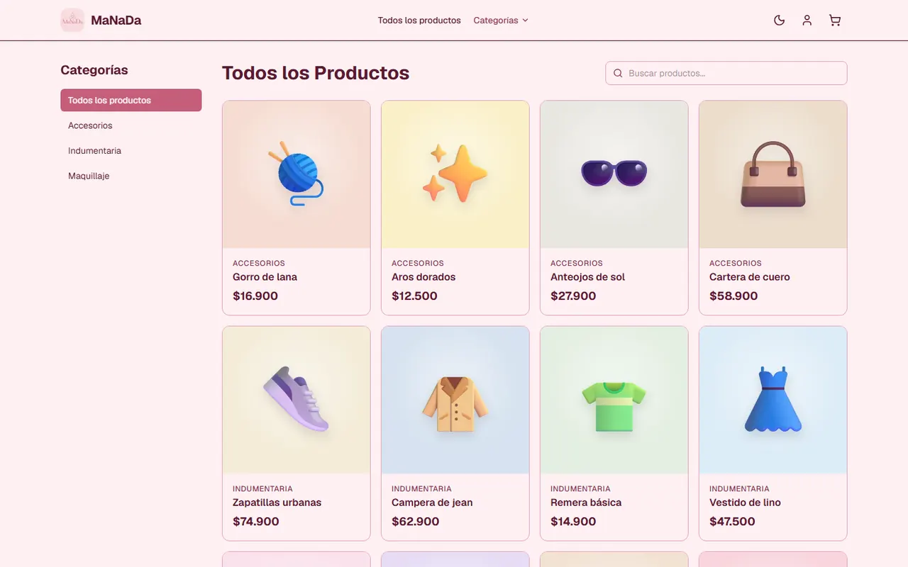
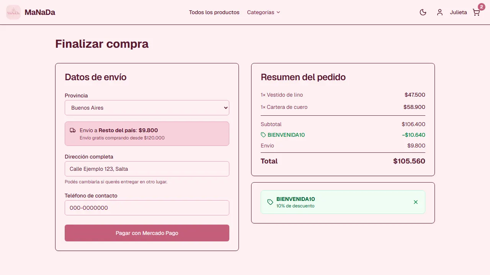
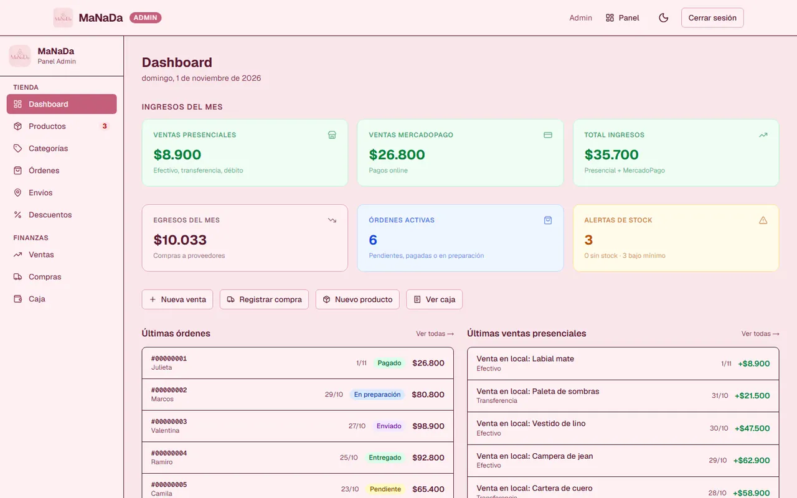
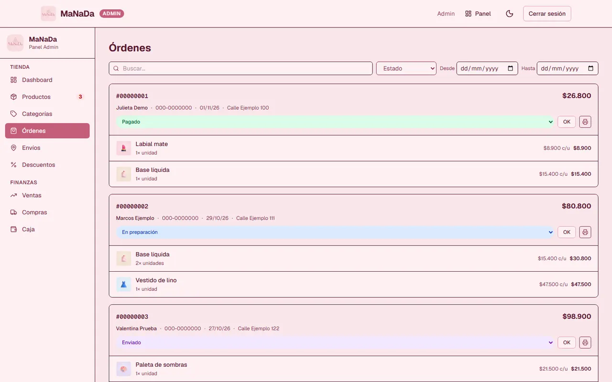
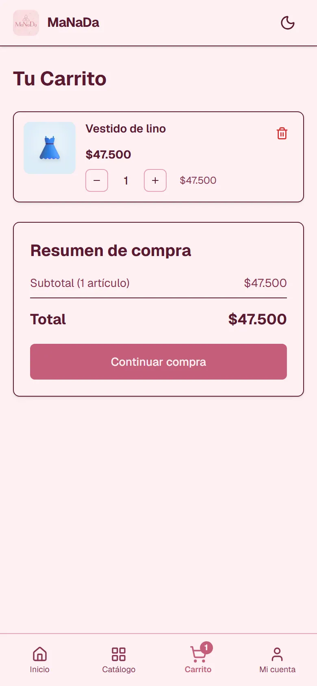
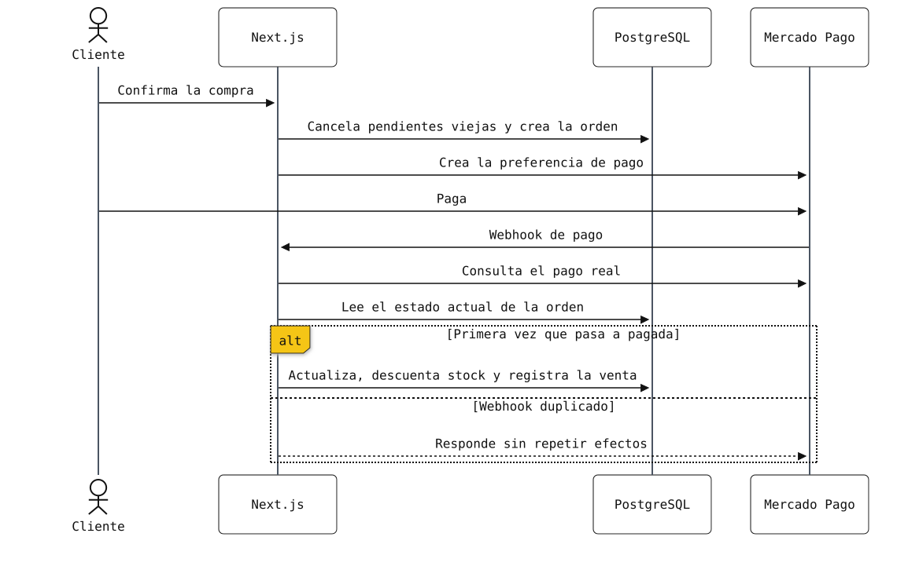

# MaNaDa · Ecommerce

Tienda online de indumentaria, maquillaje y accesorios con **pagos por Mercado Pago**, más un **panel de administración** que junta en un solo lugar las ventas web, las ventas en el local, las compras y la caja. Proyecto freelance (mar – jun 2026).

> Caso de estudio completo: [ivan-gutierrez.netlify.app](https://ivan-gutierrez.netlify.app/es/projects/manada/)

         

## Pantallas

| Catálogo | Checkout |
|---|---|
|  |  |
| **Dashboard del admin** | **Órdenes** |
|  |  |

<p>
  
  &nbsp;
  
</p>

*Capturas con datos ficticios.*

## Qué hace

**Tienda**

- Catálogo con categorías, búsqueda con sugerencias y detalle de producto.
- Carrito persistente (Zustand), códigos de descuento y checkout con **Mercado Pago**.
- Cuenta de cliente con historial de pedidos y mails de confirmación, envío y cambio de estado (Resend).

**Panel de administración**

- Dashboard con ventas del mes, órdenes y alertas de stock.
- Productos (con compresión de imágenes antes de subirlas), categorías y descuentos.
- Órdenes y envíos, ventas en el local, compras a proveedores y **una sola caja** que suma todo.

## Decisiones técnicas

### El webhook confirma el pago y es idempotente
La orden no se marca como pagada cuando el cliente vuelve de Mercado Pago, sino cuando llega el **webhook**. El webhook no confía en lo que recibe: **consulta el pago real** a la API de Mercado Pago. Además, lee el estado actual de la orden y solo ejecuta los efectos (descontar stock, registrar la venta) **la primera vez que pasa a pagada**. Si Mercado Pago reenvía el aviso, responde sin repetir nada.



### Stock atómico en una función SQL
El descuento de stock se hace en una función de PostgreSQL (`deduct_order_stock`) que se llama por RPC, así dos compras simultáneas no pueden vender la misma unidad.

### Reintentos sin órdenes acumuladas
Si el cliente vuelve a intentar pagar, las órdenes pendientes anteriores se cancelan antes de crear la nueva.

### Permisos en la base
Las tablas tienen **Row Level Security**: cada cliente ve solo sus órdenes y solo un admin (función `is_admin()`) puede modificar el catálogo. Las operaciones del servidor que necesitan saltear RLS usan la service role key, que nunca llega al navegador.

### Pruebas E2E
**Playwright** cubre login, permisos del panel, catálogo, búsqueda, carrito y las pantallas del admin, en escritorio y celular.

## Correr en local

Requisitos: Node 20 o superior y un proyecto de [Supabase](https://supabase.com).

```bash
npm install
```

Crear `.env.local` con:

```bash
NEXT_PUBLIC_SUPABASE_URL=
NEXT_PUBLIC_SUPABASE_ANON_KEY=
SUPABASE_SERVICE_ROLE_KEY=
NEXT_PUBLIC_APP_URL=http://localhost:3000
MERCADOPAGO_ACCESS_TOKEN=        # token de prueba de Mercado Pago
RESEND_API_KEY=
RESEND_FROM=
CRON_SECRET=                     # protege /api/ping
```

Correr [`database/schema.sql`](database/schema.sql) en el SQL Editor de Supabase y después:

```bash
npm run dev        # http://localhost:3000
npm test           # E2E con Playwright
```

`/api/ping` corre una vez por día como cron de Vercel para que el proyecto gratuito de Supabase no se pause por inactividad.

## Estructura

```
src/
  app/
    productos/, cart/, checkout/      tienda
    mi-cuenta/                        cuenta y pedidos del cliente
    admin/                            panel: caja, ventas, compras, órdenes, envíos, productos…
    api/webhook/mercadopago/          confirmación de pagos
    api/ping/                         cron de mantenimiento
  components/                         UI, carrito, layout y admin
  emails/                             plantillas de mail (Resend)
  lib/supabase/                       clientes de Supabase (navegador, servidor, admin)
  store/                              estado del carrito (Zustand)
database/schema.sql                   esquema y políticas RLS
tests/e2e/                            pruebas Playwright
```

---

Desarrollado por **Iván Gutiérrez** · [Portfolio](https://ivan-gutierrez.netlify.app) · [LinkedIn](https://www.linkedin.com/in/ivan-gutierrez-analista) · [GitHub](https://github.com/IvanGG97)
